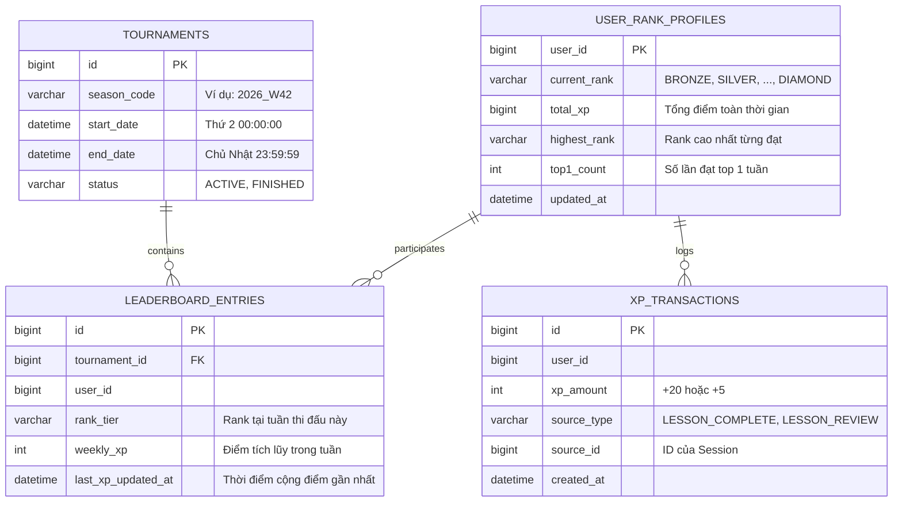

# KẾ HOẠCH THIẾT KẾ & TRIỂN KHAI HỆ THỐNG BẢNG XẾP HẠNG (LEADERBOARD SYSTEM)

> **Tài liệu đặc tả kiến trúc & kế hoạch thực hiện tính năng Bảng Xếp Hạng & Điểm Kinh Nghiệm (XP)**
> Dự án: **ENjoy - Nền tảng học tiếng Anh trực quan**

---

## 1. TỔNG QUAN YÊU CẦU & BÀI TOÁN

Theo yêu cầu từ phía người dùng và hình ảnh giao diện tham chiếu (Duolingo style):

1. **Cơ chế tích lũy Điểm Kinh Nghiệm (KN / XP)**:
   - **Học bài học mới lần đầu**: Hoàn thành nhận mặc định **+20 KN**.
   - **Học lại bài học cũ (Review)**: Hoàn thành nhận **+5 KN**.
   - **Giao diện Popup bài học**: Hiển thị nút bắt đầu kèm điểm kinh nghiệm tương ứng (`BẮT ĐẦU +20 KN` hoặc `BẮT ĐẦU +5 KN`).
2. **Hệ thống 10 Cấp Bậc (10 Leagues / Ranks)**:
   1. 🥉 **Đồng (Bronze)** *(Rank mặc định khi người dùng mới bắt đầu)*
   2. 🥈 **Bạc (Silver)**
   3. 🥇 **Vàng (Gold)**
   4. 🔷 **Lam Ngọc (Sapphire)**
   5. 🔴 **Hồng Ngọc (Ruby)**
   6. 🟢 **Ngọc Lục Bảo (Emerald)**
   7. 🟣 **Thạch Anh Tím (Amethyst)**
   8. ⚪ **Ngọc Trai (Pearl)**
   9. ⚫ **Hắc Diệu Thạch (Obsidian)**
   10. 💎 **Kim Cương (Diamond)**
3. **Quy tắc Giải Đấu Tuần (Weekly Tournament)**:
   - Chu kỳ giải đấu kéo dài **1 tuần** (Từ thứ Hai 00:00:00 đến Chủ Nhật 23:59:59).
   - **Thăng hạng**: **Top 12** người có số điểm KN cao nhất trong tuần tại rank đó sẽ được thăng hạng lên rank tiếp theo vào đầu tuần mới.
   - **Rớt hạng (tuỳ chọn)**: Nhóm cuối bảng (ví dụ rank Bạc trở lên, nếu điểm quá thấp hoặc thuộc nhóm cuối) có thể rớt hạng.
   - **Phân vùng hiển thị**: **User ở rank nào chỉ xem được bảng xếp hạng của rank đó** (Không bị lẫn lộn giữa người mới rank Đồng với người chơi lâu năm rank Kim Cương).
4. **Hiệu năng & Giới hạn truy vấn**:
   - Chỉ **query 15 user có điểm cao nhất** hiển thị lên trước (`LIMIT 15`).
   - Nếu user hiện tại không nằm trong top 15, hiển thị thêm vị trí thực tế của user ở dưới cùng.
5. **Giao diện chuẩn Duolingo**:
   - Header hiển thị dải icon các rank (sáng rank hiện tại, mờ các rank tiếp theo).
   - Tên giải đấu: *"Giải đấu [Tên Rank]"* kèm đếm ngược thời gian còn lại (ví dụ *"6 ngày"*).
   - Huy chương Top 1 (Vàng), Top 2 (Bạc), Top 3 (Đồng).
   - Đường phân cách **⬆️ NHÓM THĂNG HẠNG ⬆️** sau top 12.
   - Đường phân cách **⬇️ NHÓM RỚT HẠNG ⬇️** trước nhóm cuối.
   - Highlight thanh màu xanh lá cây cho user hiện tại.

---

## 2. KIẾN TRÚC HỆ THỐNG: CHỐT PHƯƠNG ÁN TÍCH HỢP VÀO `learning-service`

Theo lựa chọn của bạn để **tối ưu tài nguyên RAM máy tính cá nhân** (không cần phải bật thêm 1 tiến trình JVM Spring Boot mới), toàn bộ logic Gamification & Leaderboard sẽ được xây dựng dưới dạng một **Module độc lập ngay bên trong `learning-service`**:

- **Database**: Sử dụng chung database `enjoy_learning_db` với 4 bảng chuẩn hóa: `tournaments`, `user_rank_profiles`, `leaderboard_entries`, `xp_transactions`.
- **API Gateway**: Thêm tiền tố `/api/leaderboard/**` vào route của `learning-service`.
- **Giao dịch nguyên tử (Atomic Transaction)**: Khi user gọi `completeSession`, việc hoàn thành bài học và cộng điểm KN (+20 KN / +5 KN), cập nhật Rank và bảng xếp hạng tuần được thực thi liền mạch trong cùng một transaction `@Transactional`, không cần thông qua mạng hay FeignClient.
- **Tác vụ tuần (Scheduled Cron Job)**: Chạy định kỳ vào 00:00 sáng Thứ Hai trong `learning-service` bằng `@Scheduled(cron = "0 0 0 * * MON")` để tổng kết Top 12 thăng hạng và chuyển sang mùa giải mới.

---

## 3. THIẾT KẾ CƠ SỞ DỮ LIỆU (DATABASE SCHEMA)

Cơ sở dữ liệu: MariaDB / MySQL. Các bảng được chuẩn hóa:



### Chi tiết các bảng:

#### 1. Bảng `tournaments` (Mùa giải tuần)
Quản lý chu kỳ tuần thi đấu:
```sql
CREATE TABLE tournaments (
    id BIGINT AUTO_INCREMENT PRIMARY KEY,
    season_code VARCHAR(50) NOT NULL UNIQUE, -- VD: '2026_W42'
    start_date DATETIME NOT NULL,            -- Thứ Hai 00:00:00
    end_date DATETIME NOT NULL,              -- Chủ Nhật 23:59:59
    status VARCHAR(20) NOT NULL DEFAULT 'ACTIVE', -- 'ACTIVE', 'FINISHED'
    created_at DATETIME DEFAULT CURRENT_TIMESTAMP
);
```

#### 2. Bảng `user_rank_profiles` (Hồ sơ Rank người dùng)
Lưu thông tin cấp bậc hiện tại của từng người dùng:
```sql
CREATE TABLE user_rank_profiles (
    user_id BIGINT PRIMARY KEY,
    current_rank VARCHAR(30) NOT NULL DEFAULT 'BRONZE',
    total_xp BIGINT NOT NULL DEFAULT 0,
    highest_rank VARCHAR(30) NOT NULL DEFAULT 'BRONZE',
    top1_count INT NOT NULL DEFAULT 0,
    created_at DATETIME DEFAULT CURRENT_TIMESTAMP,
    updated_at DATETIME DEFAULT CURRENT_TIMESTAMP ON UPDATE CURRENT_TIMESTAMP
);
```

#### 3. Bảng `leaderboard_entries` (Bảng xếp hạng tuần theo Rank)
Lưu điểm số và thứ hạng của người dùng trong mùa giải hiện tại:
```sql
CREATE TABLE leaderboard_entries (
    id BIGINT AUTO_INCREMENT PRIMARY KEY,
    tournament_id BIGINT NOT NULL,
    user_id BIGINT NOT NULL,
    rank_tier VARCHAR(30) NOT NULL,          -- Cùng rank cạnh tranh với nhau
    weekly_xp INT NOT NULL DEFAULT 0,        -- Điểm kiếm được trong tuần
    last_xp_updated_at DATETIME DEFAULT CURRENT_TIMESTAMP,
    CONSTRAINT uk_tournament_user UNIQUE (tournament_id, user_id),
    INDEX idx_leaderboard_query (tournament_id, rank_tier, weekly_xp DESC, last_xp_updated_at ASC)
);
```
> **Điểm mấu chốt**: Index `(tournament_id, rank_tier, weekly_xp DESC, last_xp_updated_at ASC)` giúp truy vấn Top 15 cực nhanh:
> ```sql
> SELECT * FROM leaderboard_entries 
> WHERE tournament_id = :activeTournamentId 
>   AND rank_tier = :userCurrentRank 
> ORDER BY weekly_xp DESC, last_xp_updated_at ASC 
> LIMIT 15;
> ```
> *Khi hai người bằng điểm nhau, ai đạt điểm trước (`last_xp_updated_at ASC`) sẽ đứng trên.*

#### 4. Bảng `xp_transactions` (Lịch sử cộng điểm)
Audit log minh bạch nguồn gốc cộng điểm:
```sql
CREATE TABLE xp_transactions (
    id BIGINT AUTO_INCREMENT PRIMARY KEY,
    user_id BIGINT NOT NULL,
    xp_amount INT NOT NULL,                 -- +20 hoặc +5
    source_type VARCHAR(50) NOT NULL,       -- 'LESSON_FIRST_COMPLETE', 'LESSON_REVIEW'
    source_id BIGINT NOT NULL,              -- sessionId
    created_at DATETIME DEFAULT CURRENT_TIMESTAMP
);
```

---

## 4. CHI TIẾT LOGIC NGHIỆP VỤ (BUSINESS LOGIC)

### 4.1. Quy tắc cộng điểm bài học (+20 KN vs +5 KN)
Khi người dùng hoàn thành một session qua API `POST /api/progress/complete`:
1. Kiểm tra bảng `user_progress` với `userId` và `sessionId`:
   - **Trường hợp 1 (Bài mới)**: Chưa có bản ghi hoặc bản ghi có `status != 'FINISH'` trước đó:
     - Thưởng **+20 KN** (`LESSON_FIRST_COMPLETE`).
   - **Trường hợp 2 (Học lại / Ôn tập)**: Đã có bản ghi và `status == 'FINISH'`:
     - Thưởng **+5 KN** (`LESSON_REVIEW`).
2. Ghi nhận giao dịch vào `xp_transactions`.
3. Tăng `total_xp` trong `user_rank_profiles`.
4. Tìm hoặc tạo `leaderboard_entries` của user trong tuần hiện tại:
   - Tăng `weekly_xp = weekly_xp + addedXp`.
   - Cập nhật `last_xp_updated_at = NOW()`.
5. Trả về kết quả trong response gồm: `earnedXp`, `weeklyXp`, `currentRank`, `userRankPosition`.

### 4.2. Danh sách 10 Bậc Rank (Rank Tiers)
Định nghĩa Enum trong Java:
```java
public enum RankTier {
    BRONZE(1, "Đồng", "Bronze", "#cd7f32"),
    SILVER(2, "Bạc", "Silver", "#c0c0c0"),
    GOLD(3, "Vàng", "Gold", "#ffd700"),
    SAPPHIRE(4, "Lam Ngọc", "Sapphire", "#0f52ba"),
    RUBY(5, "Hồng Ngọc", "Ruby", "#e0115f"),
    EMERALD(6, "Ngọc Lục Bảo", "Emerald", "#50c878"),
    AMETHYST(7, "Thạch Anh Tím", "Amethyst", "#9966cc"),
    PEARL(8, "Ngọc Trai", "Pearl", "#eae0c8"),
    OBSIDIAN(9, "Hắc Diệu Thạch", "Obsidian", "#3b3c36"),
    DIAMOND(10, "Kim Cương", "Diamond", "#b9f2ff");

    private final int level;
    private final String nameVi;
    private final String nameEn;
    private final String hexColor;

    public RankTier getNextRank() {
        if (this == DIAMOND) return DIAMOND; // Rank cao nhất không thăng thêm
        return values()[this.ordinal() + 1];
    }
}
```

### 4.3. Cơ chế Chốt giải đấu & Thăng hạng hàng tuần (Weekly Reset Job)
Sử dụng Spring `@Scheduled(cron = "0 0 0 * * MON")` (Chạy vào 00:00 Thứ Hai mỗi tuần):
1. **Lấy giải đấu hiện tại** đang có `status = 'ACTIVE'`.
2. **Xét duyệt từng Rank** (từ `BRONZE` đến `DIAMOND`):
   - Query danh sách bảng điểm của mùa giải vừa kết thúc theo từng `rank_tier`, sắp xếp `weekly_xp DESC, last_xp_updated_at ASC`.
   - Lấy **Top 12 user đứng đầu**:
     - Cập nhật `current_rank = currentRank.getNextRank()`.
     - Nếu về vị trí top 1: Tăng `top1_count = top1_count + 1`.
     - Cập nhật `highest_rank` nếu rank mới vượt rank cũ.
3. Đánh dấu giải đấu cũ là `status = 'FINISHED'`.
4. Tạo mới mùa giải tiếp theo: `season_code = [Năm]_W[Tuần_Mới]`, `status = 'ACTIVE'`, thời gian từ Thứ Hai đến Chủ Nhật.
5. Tạo sẵn bản ghi `leaderboard_entries` với `weekly_xp = 0` và `rank_tier` mới cho tuần thi đấu mới.

---

## 5. THIẾT KẾ REST API

| Method | Endpoint | Mô tả |
| :--- | :--- | :--- |
| `GET` | `/api/leaderboard/current` | Lấy dữ liệu giải đấu tuần hiện tại, thông tin rank của user, Top 15 và vị trí của user. |
| `GET` | `/api/leaderboard/ranks` | Danh sách thông tin 10 bậc rank để render thanh tiến trình. |
| `GET` | `/api/leaderboard/my-status` | Lấy thông tin rank cá nhân, tổng XP, số ngày còn lại của mùa giải. |
| `POST` | `/api/progress/complete` | *(Mở rộng API hiện có)* Tự động tính điểm +20 hoặc +5 và cập nhật bảng xếp hạng. |

### Dữ liệu trả về mẫu của `GET /api/leaderboard/current`:
```json
{
  "tournament": {
    "seasonCode": "2026_W42",
    "daysRemaining": 6,
    "endDate": "2026-10-25T23:59:59"
  },
  "currentRank": {
    "tier": "SILVER",
    "nameVi": "Bạc",
    "level": 2,
    "color": "#c0c0c0"
  },
  "promotionThreshold": 12,
  "topUsers": [
    {
      "rank": 1,
      "userId": 101,
      "username": "tripp",
      "avatarUrl": "https://...",
      "weeklyXp": 50,
      "isCurrentUser": false
    },
    {
      "rank": 2,
      "userId": 102,
      "username": "villeda",
      "avatarUrl": "https://...",
      "weeklyXp": 20,
      "isCurrentUser": false
    },
    {
      "rank": 8,
      "userId": 88,
      "username": "Tá ka bần",
      "avatarUrl": "https://...",
      "weeklyXp": 13,
      "isCurrentUser": true
    }
  ],
  "currentUserEntry": {
    "rank": 8,
    "userId": 88,
    "username": "Tá ka bần",
    "avatarUrl": "https://...",
    "weeklyXp": 13,
    "isPromoting": true
  }
}
```

---

## 6. KẾ HOẠCH TRIỂN KHAI FRONTEND (GIAO DIỆN)

### 6.1. Cập nhật Sidebar Navigation
- Thêm mục **"BẢNG XẾP HẠNG"** vào `SidebarLeft.tsx`:
  - Path: `/leaderboard`
  - Icon: Shield/Trophy (Chiếc khiên giải đấu Duolingo).

### 6.2. Cập nhật Tooltip Bắt đầu Bài học (`LearningMap.tsx`)
- Tùy biến nút bắt đầu:
  - Nếu bài học chưa từng hoàn thành: hiển thị **`BẮT ĐẦU +20 KN`**.
  - Nếu bài học đã hoàn thành (`SessionStatus.FINISH`): hiển thị **`LUYỆN TẬP +5 KN`** hoặc **`BẮT ĐẦU +5 KN`**.
- Tạo khối popup màu tím/gradient bo tròn và mũi tên trỏ chuẩn theo thiết kế ở ảnh 2.

### 6.3. Xây dựng trang Bảng Xếp Hạng (`/leaderboard`)
- Tạo folder `web/enjoy-web/src/features/leaderboard/`:
  - `LeaderboardPage.tsx`: Màn hình chính.
  - `components/RankBadgeBar.tsx`: Dải huy hiệu 10 rank ở trên cùng.
  - `components/LeaderboardItem.tsx`: Dòng từng user (avatar, tên, huy chương 1-2-3, điểm KN, viền xanh lá khi là user hiện tại).
  - `components/PromotionDivider.tsx`: Dòng phân cách "⬆️ NHÓM THĂNG HẠNG ⬆️" và "⬇️ NHÓM RỚT HẠNG ⬇️".
  - `components/StickyUserFooter.tsx`: Thẻ ghim đáy màn hình nếu user nằm ngoài top 15.

---

## 7. CÁC BƯỚC THỰC HIỆN TIẾP THEO

1. **Bước 1**: Thống nhất phương án kiến trúc Backend:
   - *Lựa chọn 1*: Tạo service mới `leaderboard-service` (Đúng chuẩn microservice).
   - *Lựa chọn 2*: Tích hợp vào `learning-service` (Gọn nhẹ, tiết kiệm RAM máy tính).
2. **Bước 2**: Viết Entities, Repositories, Services và Cron Job chốt tuần.
3. **Bước 3**: Cập nhật logic cộng điểm (+20 / +5) trong `completeSession`.
4. **Bước 4**: Bổ sung Route trong API Gateway.
5. **Bước 5**: Triển khai giao diện Popup bài học và Trang Bảng Xếp Hạng trên Web Frontend.
6. **Bước 6**: Kiểm thử toàn diện: Làm bài -> Tăng điểm -> Xem bảng xếp hạng -> Chạy thử thăng hạng tuần.
